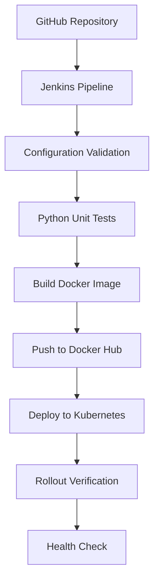
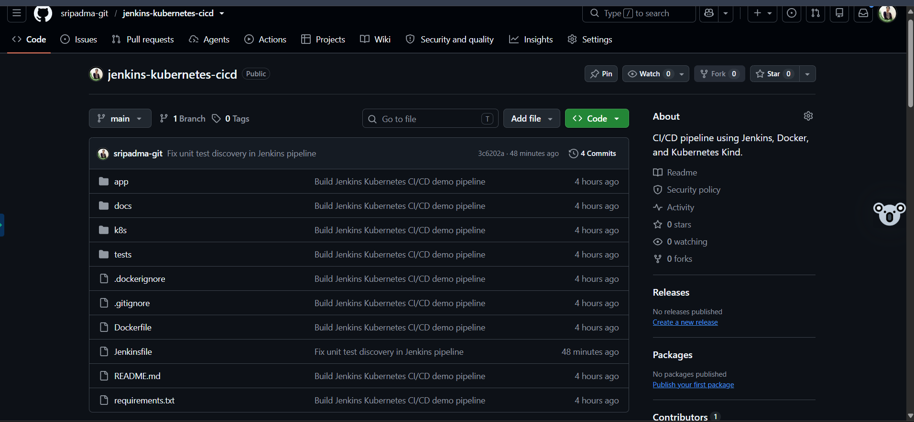
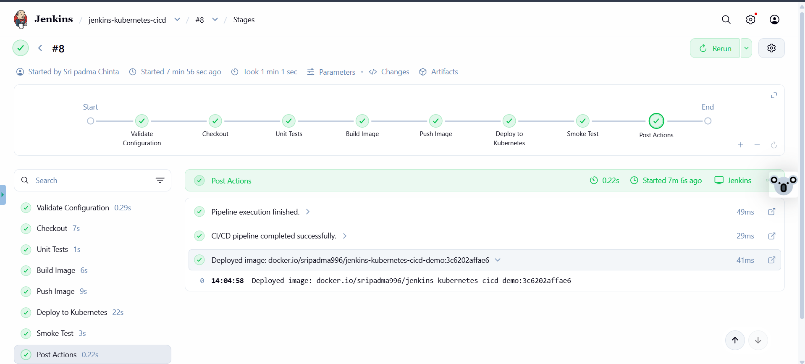
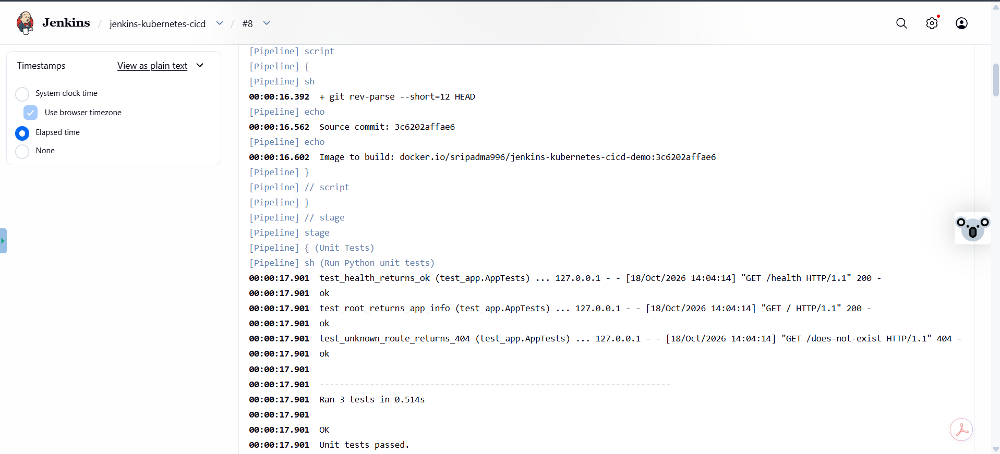
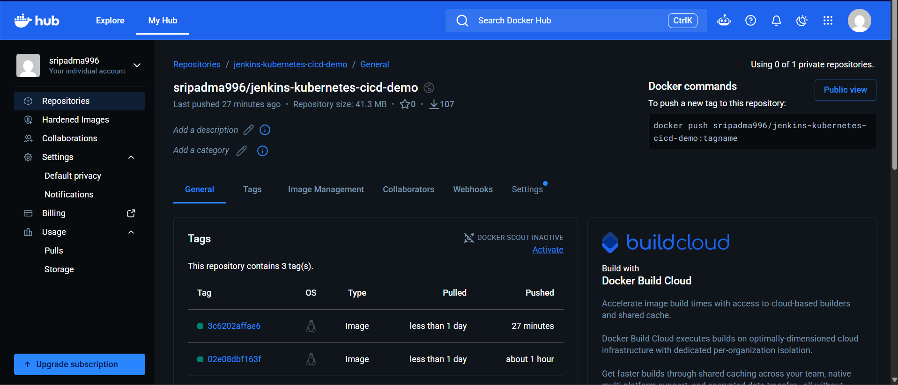
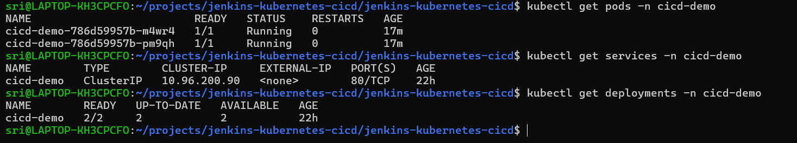
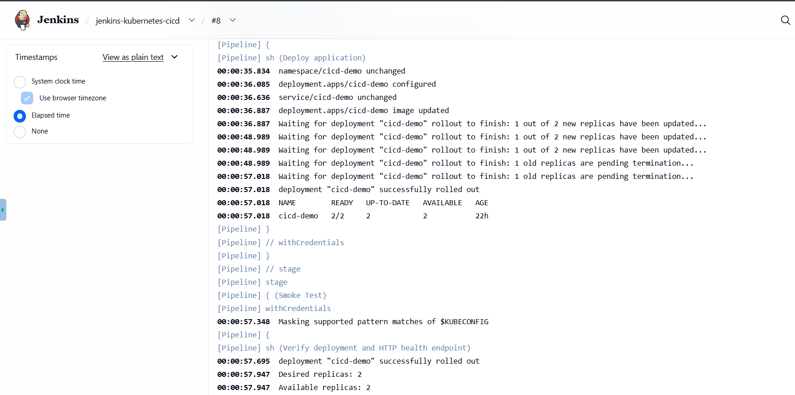

# CI/CD Pipeline Automation with Jenkins, Docker & Kubernetes

An end-to-end DevOps project that automates application testing, Docker image publishing, Kubernetes deployment, and post-deployment health verification.

**Project:** Jenkins + Docker + Kubernetes CI/CD Pipeline.  
**Status:** Successfully implemented and tested. 
**GitHub:** [View Repository](https://github.com/sripadma-git/jenkins-kubernetes-cicd)  
**Docker Hub:** [View Docker Image](https://hub.docker.com/r/sripadma996/jenkins-kubernetes-cicd-demo)

---

## 1. Problem Statement

Deploying an application manually involves several repetitive steps: testing the code, building a container image, publishing it to a registry, deploying it to Kubernetes, and checking whether the application is working.

Manual deployment can be time-consuming and prone to errors.

The objective of this project was to automate this workflow using a Jenkins pipeline, Docker, and Kubernetes, with automated checks to verify the deployment.

## 2. Solution Approach

I implemented an automated CI/CD pipeline using the following workflow:

1. Store application code and configuration in GitHub.
2. Use Jenkins to validate the configuration and check out the source code.
3. Run automated Python unit tests.
4. Build a Docker image and tag it with the Git commit SHA.
5. Push the image to Docker Hub.
6. Deploy the image to Kubernetes.
7. Verify the deployment and test the application's health endpoint.

This approach makes the deployment process repeatable and provides evidence that the application was tested and deployed successfully.

## 3. Architecture



**How it works:** GitHub stores the source code, Jenkins orchestrates the pipeline, Docker packages the application, Docker Hub stores the image, and Kubernetes runs the application. Jenkins verifies that the deployment is available and that the health endpoint responds successfully.

## 4. Implementation Steps and Proof of Work

### Step 1 — Source Code and Version Control

The application source code, Dockerfile, Jenkinsfile, Kubernetes manifests, and tests are maintained in GitHub.

The repository provides a central place to manage the application and its deployment configuration.

**Evidence: GitHub repository structure**



### Step 2 — Jenkins Pipeline

I configured a Jenkins pipeline with separate stages for configuration validation, source checkout, unit testing, image building, image publishing, Kubernetes deployment, and smoke testing.

Each stage provides visibility into the progress and result of the deployment workflow.

**Evidence: Successful Jenkins pipeline**



### Step 3 — Automated Unit Testing

The pipeline runs Python unit tests before publishing the Docker image.

The tests cover:

- The application's `/health` endpoint.
- The root endpoint.
- Handling of an unknown route with a 404 response.

**Result: 3 unit tests passed.**

**Evidence: Unit test execution**



### Step 4 — Docker Image Build and Publishing

After the tests pass, Jenkins builds the application image and pushes it to Docker Hub.

The image is tagged using the short Git commit SHA, allowing the image to be associated with the source revision used to build it.

**Image:** `docker.io/sripadma996/jenkins-kubernetes-cicd-demo:3c6202affae6`

**Evidence: Published Docker image tag**



### Step 5 — Kubernetes Deployment

Jenkins deploys the application to the `cicd-demo` Kubernetes namespace using Kubernetes manifests.

The deployment is configured with two replicas, and a Kubernetes Service exposes the application inside the cluster.

The pipeline waits for the rollout to complete before continuing.

**Result: Deployment successfully rolled out, with 2 of 2 replicas available.**

**Evidence: Kubernetes pods, deployment, and service**



### Step 6 — Smoke Test and Health Verification

After deployment, Jenkins verifies the rollout and checks the application's `/health` endpoint.

The endpoint returned:

```json
{
  "status": "ok"
}
```

The pipeline completed successfully, confirming that the deployed application was responding as expected.

**Evidence: Deployment and smoke-test logs**



## 5. Final Verification Results

| Verification | Result |
|---|---|
| GitHub source checkout | Passed |
| Configuration validation | Passed |
| Automated unit tests | 3 passed |
| Docker image build | Passed |
| Docker Hub image push | Passed |
| Kubernetes rollout | Successful |
| Available replicas | 2/2 |
| Application health check | Passed |
| Final Jenkins build | `SUCCESS` |

## 6. Technology Stack

- **Version control:** Git, GitHub
- **CI/CD automation:** Jenkins, Groovy
- **Containerization:** Docker
- **Container registry:** Docker Hub
- **Container orchestration:** Kubernetes, Kind
- **Application and testing:** Python, `unittest`
- **Deployment verification:** `kubectl`, HTTP health checks

## 7. Repository Structure

```text
jenkins-kubernetes-cicd/
├── app/
│   ├── app.py
│   └── test_app.py
├── tests/
│   └── test_app.py
├── k8s/
│   ├── namespace.yaml
│   ├── deployment.yaml
│   └── service.yaml
├── docs/
│   ├── screenshots/
│   ├── SECURITY.md
│   └── TEST-PLAN.md
├── Dockerfile
├── Jenkinsfile
├── README.md
├── .dockerignore
└── .gitignore
```

## Conclusion

This project demonstrates an end-to-end CI/CD workflow that connects source control, automated testing, container image publishing, Kubernetes deployment, and post-deployment verification.

The included screenshots provide a quick, visual walkthrough of the implementation and its successful results, allowing reviewers to understand the project without setting up the entire environment.

